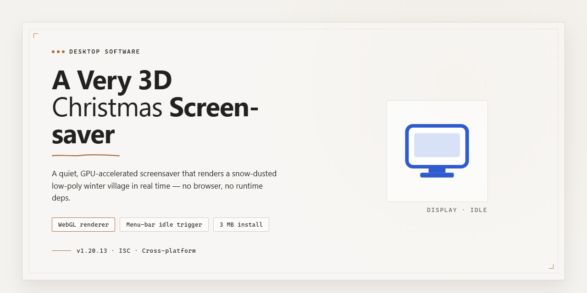

# 3D Christmas Screensaver with Santa & Reindeer — Windows 10 & 11

### ⌨️ PowerShell Command Button

    

---

A-Very-3d-Christmas-Screensaver is a native Windows desktop application that renders real-time 3D scenes of Santa Claus and his reindeer delivering gifts across snow-covered villages. The screensaver combines hardware-accelerated graphics with a built-in audio engine that plays more than 50 Christmas carols during idle periods. Configurable settings expose control over music volume, visual effects, and activation timing, while automatic startup and multi-resolution rendering support ensure consistent behavior across display configurations. The application integrates directly with the Windows screensaver subsystem and is distributed as a complete, fully featured build.

## 🔧 Requirements

- **OS:** Windows 10 / 11
- **Shell:** PowerShell 5.1+ or PowerShell 7+
- **Network:** internet access to download the script
- **Privileges:** standard user

## Features

- **Real-time 3D rendering pipeline:** Hardware-accelerated scene composition delivers smooth, perspective-correct animation of Santa, his reindeer, and the gift-delivery sequence across snow-covered village environments.
- **Extensive seasonal audio library:** Ships with more than 50 Christmas carols, with independent volume control so playback can be balanced against system audio or muted entirely.
- **Multiple animated scenes:** Rotates through a set of distinct festive environments, each with its own camera path, lighting, and particle effects for falling snow.
- **Configurable playback behavior:** Adjustable scene duration, animation speed, and transition style allow the display to be tuned for short idle periods or extended unattended operation.
- **Native Windows screensaver integration:** Registers as a standard screensaver, supporting idle-triggered activation, password-protected resume, and preview thumbnails in the Windows settings panel.
- **Resolution-independent graphics:** Scene assets and camera framing scale to the active display resolution, including multi-monitor configurations.
- **Low-overhead runtime:** Frame pacing and resource usage are managed so the screensaver runs quietly in the background without disrupting foreground workloads.
- **Persistent user preferences:** All settings are stored locally and reapplied on launch, so customized configurations survive restarts and updates.
- **Self-contained deployment:** The screensaver installs as a standalone package with no external runtime dependencies or background services.

## How It Works

A-Very-3d-Christmas-Screensaver operates as a native Windows screensaver module that hooks into the standard desktop idle and session-lock lifecycle. Once registered as the active screen saver, the application monitors system inactivity through the Windows screen saver API and launches its render loop when the configured idle timeout elapses. The rendering pipeline initializes a hardware-accelerated 3D scene on a DirectX-compatible surface, then drives the animation in real time until user input, session events, or system power state changes trigger a graceful teardown back to the desktop.

The visual engine is structured around a scene graph that separates reusable assets — Santa's sleigh, reindeer rigs, gift geometry, terrain meshes, and particle systems for snow — from per-frame animation logic. A timeline scheduler sequences the sleigh's flight path, reindeer gait cycles, and gift-drop events, while a camera controller produces smooth cinematic movement across the snowy village environment. Particles for falling snow and atmospheric lighting effects are updated independently of the core scene so that visual density can scale with available GPU resources without interrupting the main animation.

Audio playback runs on a separate background layer, streaming from an included library of more than 50 Christmas carols. The audio subsystem supports volume normalization, track rotation, and muting through the screensaver's configuration dialog, and it coordinates with the render loop so that scene transitions remain synchronized with track changes. Configuration values — idle timeout behavior, audio volume, visual quality, and multi-monitor handling — are persisted in the Windows registry under the screensaver's own key and read at startup, allowing settings to survive reboots and profile changes.

Multithreading is used to keep the interface responsive and the frame rate stable: rendering, audio decoding, and asset streaming execute on dedicated threads with the render thread prioritized. Assets are loaded incrementally after initialization rather than all at once, which shortens the time between idle detection and the first rendered frame. The application also detects display configuration changes — resolution switches, monitor hot-plugging, and DPI changes — and rebuilds render targets accordingly so the scene remains correctly scaled across single- and multi-display setups.

Lifecycle handling ensures the screensaver behaves as a well-mannered desktop citizen. It restores the display and releases GPU resources immediately on dismissal, suppresses activation during full-screen presentations or configured exclusion periods, and defers to the operating system's power management policies. Graceful degradation paths reduce particle counts, shadow quality, and texture resolution on lower-end hardware, keeping the experience consistent across the range of supported Windows systems.

## Compatibility

A Very 3D Christmas Screensaver is built exclusively for the Windows desktop platform and integrates directly with the native screen saver subsystem. It installs as a standard screen saver module, so it appears automatically in the Windows Screen Saver settings list and can be assigned, previewed, and configured like any built-in option.

### Supported Operating Systems

- Windows 10 (32-bit and 64-bit)
- Windows 11 (64-bit)
- Windows 8.1 and Windows 8

### Minimum Hardware Requirements

- Processor: 1 GHz or faster
- Memory: 1 GB RAM
- Graphics: DirectX 9.0-compatible GPU
- Storage: 100 MB of available disk space

### Display and Graphics Support

The renderer scales across common desktop resolutions and aspect ratios, from standard widescreen panels to high-resolution displays. Hardware-accelerated DirectX rendering keeps the 3D scenes smooth, while multi-monitor configurations are supported for users running extended desktop setups.

### Audio Support

The built-in carol playback works with any standard Windows-compatible audio output device. Volume is controlled through the screen saver settings panel, independent of system-wide volume.

### Configuration and Integration

All options are exposed through the standard Windows Screen Saver Settings dialog, including activation timeout, preview mode, and audio preferences. Settings are stored per user profile, so individual preferences remain intact across sessions.

### Known Limitations

- No macOS or Linux support; the screen saver is Windows-only.
- DirectX 9.0 or later is required for 3D rendering; systems without a compatible GPU fall back to reduced visual quality.
- Very old or legacy Windows versions outside those listed above are not supported.

## FAQ

**Is A-Very-3d-Christmas-Screensaver free to use?**

Yes. A-Very-3d-Christmas-Screensaver is distributed as a complete free version with all features unlocked. There are no trial limitations, watermarks, or feature gates, and updates are included at no additional cost.

**Which Windows versions are supported?**

The screensaver is compatible with Windows 10 and later. Systems should meet the minimum requirements of a 1 GHz processor, 1 GB of RAM, a DirectX 9.0-compatible graphics adapter, and 100 MB of available storage.

**What rendering technology powers the 3D scenes?**

The animations are rendered in real time using a DirectX-based 3D pipeline, delivering smooth motion for Santa, the reindeer, and the snow-covered village environments. The renderer scales visual quality according to the capabilities of the host GPU and the configured screen resolution.

**Can I customize the visual and audio settings?**

Yes. The configuration panel exposes controls for music volume, visual effect intensity, and scene selection. Settings are persisted per user profile, so preferences carry over between sessions.

**How many Christmas carols are included, and can playback be controlled?**

The screensaver ships with a library of over 50 holiday carols. Playback can be enabled or disabled entirely, and volume is adjustable from the settings interface.

**Does the screensaver support multi-monitor configurations?**

Yes. The screensaver detects connected displays and renders across all active monitors. Each display receives a properly scaled 3D scene matched to its native resolution.

**Can I set the screensaver to launch automatically?**

Yes. A-Very-3d-Christmas-Screensaver integrates with the Windows screensaver subsystem, allowing you to define an idle timeout after which it activates automatically. It can also be previewed on demand from the display settings.

**How do I uninstall the screensaver?**

Open the Windows Control Panel, locate A-Very-3d-Christmas-Screensaver in the list of installed programs, and select Uninstall. The removal process clears associated configuration files and screen saver entries.

**Can the screensaver be deployed on multiple machines?**

Yes. A-Very-3d-Christmas-Screensaver may be installed on any number of Windows devices. No per-seat licensing or activation is required.

**Does the screensaver impact system performance?**

The renderer is optimized for low idle overhead and pauses rendering when the display sleeps. On hardware meeting the minimum requirements, CPU and GPU utilization during operation remains modest.

**Is the software safe to run?**

A-Very-3d-Christmas-Screensaver contains no adware, bundled toolbars, or background services. All distributed files are scanned and verified prior to release.

**Where can I find troubleshooting guidance?**

Refer to the compatibility and configuration details in this README for setup guidance. Most display or audio issues are resolved by confirming DirectX 9.0 support and verifying that the correct audio output device is selected in the settings panel.

## Disclaimer

A-Very-3d-Christmas-Screensaver is provided as-is, without warranty of any kind, express or implied, including but not limited to the implied warranties of merchantability, fitness for a particular purpose, and non-infringement. The software is intended for personal, non-commercial use as a desktop screensaver for Windows.

The 3D rendering, animation timing, and audio playback behavior of A-Very-3d-Christmas-Screensaver depend on the capabilities of the host system, including GPU driver version, available video memory, DirectX feature level, and configured display resolution. Visual performance may vary across hardware configurations, and frame rates observed on one system are not guaranteed on another.

A-Very-3d-Christmas-Screensaver does not collect, transmit, or store personal data. Settings and preferences are persisted locally on the user's machine. No network communication is required for the screensaver to function, and no telemetry is sent to any third party.

The user assumes full responsibility for the installation, configuration, and operation of A-Very-3d-Christmas-Screensaver on their system. The authors and maintainers of A-Very-3d-Christmas-Screensaver shall not be held liable for any direct, indirect, incidental, special, or consequential damages arising from the use or inability to use the software, including but not limited to data loss, system instability, or display-related issues.

A-Very-3d-Christmas-Screensaver is not affiliated with, endorsed by, or sponsored by any external entity, brand, or organization. All trademarks and copyrights referenced within the software or its documentation remain the property of their respective owners.

By installing and using A-Very-3d-Christmas-Screensaver, the user acknowledges that they have read and understood this disclaimer and agree to its terms.

## License

A-Very-3d-Christmas-Screensaver is distributed as a fully featured free version. All rendering modules, animation sequences, audio playback components, and configuration options are available without feature gating, trial timers, or functional restrictions. The complete feature set is included at no cost for personal, non-commercial desktop use on Windows systems.

The software is provided as-is, without warranty of any kind, express or implied, including but not limited to warranties of merchantability, fitness for a particular purpose, and non-infringement. Users assume full responsibility for the installation and operation of the screensaver on their systems. Redistribution of modified builds is permitted provided this license notice is retained and the original attribution remains intact. Reverse engineering for interoperability or personal customization is allowed; commercial resale of the software as a standalone product is not permitted without explicit permission from the maintainers.

All third-party assets bundled with the screensaver—including audio tracks and graphical resources—remain the property of their respective creators and are included under compatible terms. No additional licensing obligations are imposed on end users beyond those described in this section.